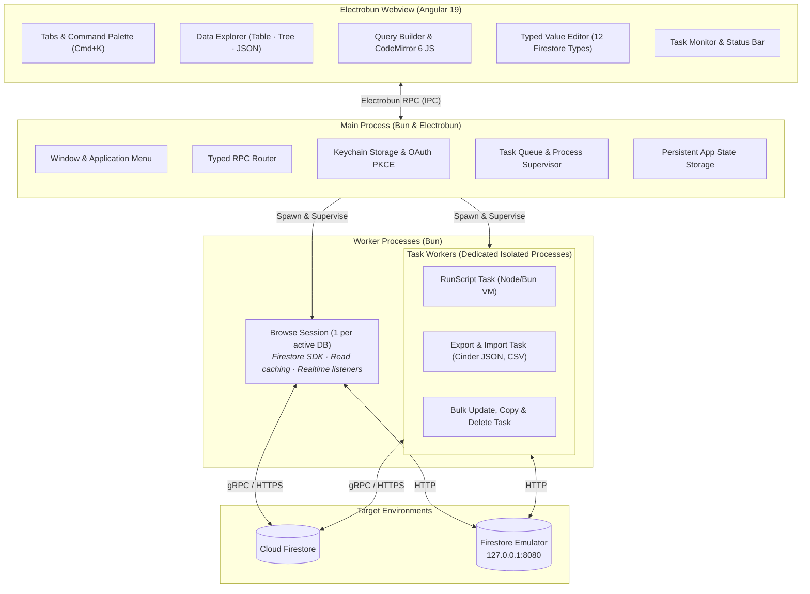

<p align="center">
  
</p>

<h1 align="center">Cinder</h1>

<p align="center">
  <b>A fast, open-source desktop GUI client for Google Cloud Firestore</b><br>
  Realtime data exploration, visual query builder, script execution, and lossless multi-format import/export.
</p>

<p align="center">
  
  
  
  
  
  <a href="LICENSE"></a>
  <a href="CONTRIBUTING.md"></a>
</p>

<p align="center">
  <a href="#why-cinder">Why Cinder</a> ·
  <a href="#features">Features</a> ·
  <a href="#getting-started">Getting started</a> ·
  <a href="#architecture">Architecture</a> ·
  <a href="#shortcuts">Shortcuts</a> ·
  <a href="#data-formats">Data formats</a> ·
  <a href="#security--privacy">Security & Privacy</a> ·
  <a href="CONTRIBUTING.md">Contributing</a>
</p>

---

## Why Cinder

Managing Google Cloud Firestore through the web console can be cumbersome: queries are restrictive, local emulator integration is separate, bulk data operations are painful, and navigating large collections requires constant clicking. Traditional desktop database clients are frequently heavy Electron applications that consume gigabytes of RAM, suffer from UI latency, and can crash entirely under heavy workloads.

Cinder is built from the ground up to solve these problems:

- **Blazing Fast & Lightweight**: Powered by **[Electrobun](https://electrobun.dev)** and **[Bun](https://bun.sh)**, Cinder starts instantly, keeps a minimal memory footprint, and delivers snappy native desktop performance.
- **Process Isolation**: The main UI thread never touches the Firestore SDK. Browsing runs in dedicated database sessions, while queries, bulk mutations, and data transfers run inside isolated Bun worker processes. A heavy query or memory-intensive task will never freeze or crash the app.
- **Strict Data Fidelity**: Complete preservation of Firestore's 12 data types—including 64-bit integers, exact floating-point doubles (such as `2.0`), nanosecond timestamps, document references, geopoints, and vector embeddings.
- **Local & Cloud Native**: Connect to Google accounts with OAuth (PKCE), service account keys, or local Firestore emulators seamlessly in a single unified workspace.

## Features

| | |
| --- | --- |
| 🔐 **Flexible Authentication** | Sign in with **Google OAuth (PKCE)**, import **Service Account JSON** keys, or connect directly to local **Firestore Emulators** (`127.0.0.1:8080`). |
| 🗂️ **Multi-Project & Multi-DB** | Seamlessly manage multiple Google Cloud projects, named databases, and root collections in an expandable sidebar tree. |
| 👁️ **Three Explorer Views** | Browse collections as a **Table**, expandable **Tree**, or formatted **JSON**, with cursor-based pagination ("Load more") and subcollection navigation. |
| ✏️ **Typed Value Editor** | Precision document editor supporting string, integer (64-bit), double, boolean, null, timestamp, geopoint, reference, bytes, vector, map, and array. Writes only modified top-level fields. |
| ⚡ **Realtime Live Streams** | Follow collection changes live on screen with subtle update flashes (respects reduced motion settings). Features an automatic 5-minute idle cutoff to protect against unexpected Firebase read charges. |
| 🔍 **Visual Query Builder & Scripting** | Visually build composite queries with multiple filters (`==`, `in`, `array-contains-any`, etc.), sorting, and limits. Switch anytime to an editable **JavaScript script** powered by CodeMirror 6. |
| 📦 **Lossless Export & Import** | Stream multi-gigabyte datasets without memory leaks. Supports lossless **Cinder JSON**, **NDJSON/JSONL**, human-readable JSON, and auto-inferred **CSV** with dot-notation column mapping. |
| 🪄 **Bulk Field Updates** | Batch-update matching documents: set fields, delete, rename, atomic increment, array union/remove, or server timestamps. Includes a 20-document safe **Preview** before committing. |
| 🔀 **Copy, Move & Duplicate** | Duplicate, move, or rename documents and entire collection trees across databases, projects, and accounts, with optional reference rewriting. |
| 🗑️ **Recursive Collection Deletion** | Safely delete collections and all nested subcollections at any depth, with document count confirmation and explicit path verification. |
| 🧵 **Supervised Task Pipeline** | Track exports, imports, bulk updates, and scripts on a dedicated Tasks dashboard with live progress meters, counts, logs, and one-click cancellation. |
| ⌨️ **Command Palette & Tabs** | Press `Cmd+K` to search accounts, projects, databases, open tabs, and commands. Full multi-tab layout with persistent state across restarts. |

## Security & Privacy

- **Native Keychain Storage**: Credentials, OAuth refresh tokens, and service account keys are stored securely in the macOS Keychain under the service `app.cinder.desktop/<channel>`.
- **Zero Plaintext Secrets**: Local account metadata (`accounts.json`) and window state (`app-state.json`) are stored with restrictive `0600` permissions and never contain private keys or tokens.
- **Webview Isolation**: The Angular webview has no direct network access to Google Cloud or Firestore SDKs. All requests flow through typed Electrobun RPC boundaries to Bun background processes.
- **Secure OAuth Loopback**: Signs in via standard browser OAuth with PKCE and a temporary loopback listener on `127.0.0.1`, stopping automatically after 5 minutes.

## Getting started

### Requirements

- **macOS** (Application menus and Keychain integration) or **Windows**
- [Devbox](https://www.jetify.com/devbox) (recommended), which provides Bun 1.4.2, Node 22, and Java 21 headless (required for the Firestore emulator), or manual installation of Bun and Java.

### Build and run

```bash
# Clone repository
git clone https://github.com/lysari/cinder.git
cd cinder

# Install dependencies and prepare Electrobun devkit
cd cinder
bun install
bun run prepare:devkit

# Optional: Run the local Firestore emulator (serves 127.0.0.1:8080)
bun run emulator

# Launch Cinder in development mode
bun run dev
```

If using **Devbox** from the workspace root:

```bash
devbox run -- 'cd cinder && bun run dev'
```

> [!NOTE]
> `bun run prepare:devkit` downloads the pinned Electrobun engine release and generates the TypeScript declarations in `.hutch/devkit/`. Run this step whenever dependencies are freshly installed.

### Production build

To compile an optimized, standalone desktop application bundle:

```bash
cd cinder
bun run build
```

The resulting application bundle will be generated in `cinder/dist/`.

### Available scripts

| Command | What it does |
| --- | --- |
| `bun run dev` | Bundles webview & worker, then launches Cinder with Electrobun in dev mode |
| `bun run build` | Compiles a production application bundle for distribution |
| `bun run prepare:devkit` | Fetches the pinned Electrobun engine and generates SDK bindings |
| `bun run emulator` | Boots local Firebase Firestore emulator (`demo-cinder` on port 8080) |
| `bun run typecheck` | Validates TypeScript in Bun main process, worker, and Angular templates (`ngc`) |
| `bun run test` | Runs the test suite via `bun:test` |
| `bun run icon` | Regenerates macOS app icon set from `scripts/generate-icon.ts` |

## Architecture

Cinder decouples the user interface, background management, and database execution into distinct, isolated processes:



### Project structure

| Path | What it holds |
| --- | --- |
| [`cinder/src/bun/`](cinder/src/bun) | Electrobun main process: window lifecycle, menus, Keychain integration, RPC routers, task queuing |
| [`cinder/src/mainview/`](cinder/src/mainview) | Angular 19 frontend: Explorer, Query Builder, Value Editor, Tasks dashboard, styles |
| [`cinder/src/worker/`](cinder/src/worker) | Background worker processes: persistent browse sessions and dedicated task runners |
| [`cinder/src/shared/`](cinder/src/shared) | Shared type contracts, RPC protocols, Firestore encoding/decoding, validation |
| [`cinder/scripts/`](cinder/scripts) | Icon generation and OAuth client configuration tooling |
| [`cinder/tests/`](cinder/tests) | Test suite for workers, CSV parsers, encoders, and stores |
| [`cinder/docs/`](cinder/docs) | Comprehensive technical architecture and subsystem documentation |

## Shortcuts

| Shortcut | Action |
| --- | --- |
| <kbd>Cmd</kbd> + <kbd>K</kbd> | Open Command Palette (search accounts, projects, databases, tabs, actions) |
| <kbd>Cmd</kbd> + <kbd>T</kbd> | Open a new tab (start page) |
| <kbd>Cmd</kbd> + <kbd>W</kbd> | Close the current tab |
| <kbd>Cmd</kbd> + <kbd>Shift</kbd> + <kbd>[</kbd> | Switch to previous tab |
| <kbd>Cmd</kbd> + <kbd>Shift</kbd> + <kbd>]</kbd> | Switch to next tab |
| <kbd>Cmd</kbd> + <kbd>Enter</kbd> | Execute the current query (visual builder or JavaScript) |
| <kbd>Cmd</kbd> / <kbd>Ctrl</kbd> + click | Open link, collection, or table row in a new background tab |

## Data formats

Cinder supports four distinct formats for export and import:

- **Cinder JSON** (`.json`): Fully lossless representation preserving exact Firestore types (timestamps with nanoseconds, 64-bit integers, references, geopoints, byte arrays, vector embeddings).
- **NDJSON / JSONL** (`.ndjson`, `.jsonl`): Streamable line-delimited Cinder JSON for high-throughput, large-scale exports and imports.
- **Readable JSON** (`.json`): Standard human-readable JSON suitable for interoperability with other developer tools and APIs.
- **CSV** (`.csv`): High-speed tabular format with automatic schema detection, delimiter guessing, and dotted column paths for nested maps (e.g., `user.address.city`).

## Contributing

Bug reports, feature suggestions, and pull requests are welcome. Please start with [CONTRIBUTING.md](CONTRIBUTING.md).

## License

Cinder is released under the [MIT License](LICENSE).
